# CryptoViT — Existing Implementation Audit and Architecture Reference

**Audit scope:** read-only inspection of the checked-out repository, source and test tracing, and safe unit-test execution. No application source, existing documentation, configuration, dependencies, datasets, checkpoints, or results were changed. This report is the only file created for the audit.

## 1. Executive summary

CryptoViT is a Python project containing a from-scratch Vision Transformer (ViT), a deterministic image transformation pipeline called “hyperchaotic” encryption, a second ViT variant with a convolutional patch front end and optional key-derived positional offset, CIFAR data utilities, training/evaluation code, a FastAPI demo, and a Streamlit frontend.

**What is demonstrably working:** the encryption unit-test file ran successfully in the available Anaconda Python 3.13.9 environment: **29 passed**, including exact image encrypt/decrypt round trips for tested RGB arrays, permutation and DNA encode/decode checks. That establishes those tested functions’ behavior for those inputs; it does **not** establish cryptographic security or validate training, dataset downloading, the model, the API, or the dashboard.

**What is present but not established:** standard and CryptoViT model source, CIFAR pipelines, training and classification metrics, a security-metric module, API routes, dashboard UI, and scripts for data generation and ablations. No dataset, checkpoint, model result, experiment log, or API/dashboard execution artifact was found. The selected Pylance interpreter lacks project imports; the alternative test interpreter used for the encryption tests lacks PyTorch and OmegaConf. The entire unit suite therefore failed at collection on missing dependencies.

**Most consequential implementation gaps found in static tracing:**

1. `Trainer` and `evaluate_model` call models with images only. They never pass the key embedding. `CryptoViT` consequently uses its documented non-key-aware fallback during training and the ablation evaluation, while the API supplies a key embedding at prediction time. The key-derived positional MLP is therefore not trained through those workflows.
2. Ablations B–E use the entire CIFAR training set for training and the official test set for both validation and testing. This makes validation/test scores unsuitable as held-out results.
3. Ablations D and E build the same `CryptoViT` with the same arguments; the claimed E-specific depth/hyperparameter change is not implemented.
4. The encryption-generation script’s docstring describes train/validation/test output, but its implementation writes only train and test sets. Ablation code does not consume precomputed encrypted data.
5. The demo API can instantiate randomly initialized models when no checkpoint exists, and its health response treats any non-`None` model object as “loaded.” Inference results from that fallback are not evidence of a trained classifier.
6. “Privacy-preserving” is an experimental objective, not an end-to-end privacy guarantee: the dashboard sends plaintext to the API, which encrypts it server-side; the server receives plaintext and the key. The API also accepts already-encrypted input for direct model inference, but that alone does not secure the full client/server flow.
7. Encryption/security metrics are not a cryptographic proof. In particular, the combined metric workflow labels plaintext-versus-ciphertext differences as NPCR/UACI, rather than measuring ciphertext changes caused by a controlled plaintext perturbation under the same key.

**Conclusion:** the repository is a substantial research prototype, not a verified end-to-end system. The encryption transform has passing narrow unit tests; meaningful trained inference, fair encrypted-image comparisons, end-to-end privacy, and cryptographic security are not demonstrated.

## 2. Repository identity and current Git state

- Repository: `raadheshbajoria/CryptoVIT`
- Branch: `master`
- HEAD: `8000df8755926557159a7a520197b6e8d4d44959`
- HEAD message: `feat: complete CryptoVIT implementation — all 13 phases`
- Initial status: clean, tracking `origin/master`.
- Final status after audit and report creation: the only expected working-tree change is this new Markdown report.

The commit message is not evidence that the README’s phases, the full research pipeline, or the demo are complete.

## 3. Project purpose and problem statement

An image is a grid of numeric pixel values. An RGB image of shape `(H, W, 3)` has three 8-bit channel values at each location, normally integers from 0 to 255. A conventional classifier learns patterns from spatial relationships in those values.

Ordinary encryption aims to conceal the original data. Ciphertext generally does not preserve the useful local visual structure that an ordinary classifier expects. CryptoViT explores whether a key-derived image transformation and a model trained for the resulting representation can classify it without reconstructing the ordinary image first.

In this repository, that objective is represented by:

- A software transformation that permutes pixels and applies DNA-inspired and byte-XOR operations. Its implementation is in [`encrypt.py`](src/cryptovit/encryption/encrypt.py#L51), [`permutation.py`](src/cryptovit/encryption/permutation.py#L29), [`dna.py`](src/cryptovit/encryption/dna.py#L117), and [`diffusion.py`](src/cryptovit/encryption/diffusion.py#L44).
- A standard, randomly initialized ViT and a custom `CryptoViT`; there is no pretrained-model loading in their model code. See [`vit.py`](src/cryptovit/models/vit.py#L296) and [`cryptovit.py`](src/cryptovit/models/cryptovit.py#L48).
- An online encrypted CIFAR dataset wrapper and training/ablation scripts. See [`encrypted_dataset.py`](src/cryptovit/datasets/encrypted_dataset.py#L61) and [`run_ablation.py`](scripts/run_ablation.py#L96).

The source supports the statement that the API can pass an encrypted array directly to `CryptoViT` without decrypting it. It does not support a claim that the entire service protects the image from the API host or that its custom cipher meets a security standard.

## 4. Actual repository structure

The following tree lists tracked project files, not a generic Python template. There are no tracked `data/`, `experiments/`, `notebooks/`, or saved model files in the inspected checkout. The `.gitignore` anticipates data and experiment outputs, but those directories were absent in the filesystem inventory.

```text
CryptoVIT/
├── .gitattributes
├── .gitignore
├── README.md
├── pyproject.toml
├── pytest.ini
├── setup.cfg
├── api/
│   └── main.py
├── configs/
│   ├── base.yaml
│   ├── cifar100.yaml
│   └── experiment_phase1.yaml
├── dashboard/
│   └── app.py
├── scripts/
│   ├── download_cifar.py
│   ├── generate_encrypted_data.py
│   ├── phase1_dataset_check.py
│   ├── run_ablation.py
│   └── train_baseline.py
├── src/cryptovit/
│   ├── __init__.py
│   ├── datasets/
│   │   ├── __init__.py
│   │   ├── cifar_dataset.py
│   │   └── encrypted_dataset.py
│   ├── encryption/
│   │   ├── __init__.py
│   │   ├── chaotic_map.py
│   │   ├── diffusion.py
│   │   ├── dna.py
│   │   ├── encrypt.py
│   │   ├── key_generator.py
│   │   └── permutation.py
│   ├── evaluation/
│   │   ├── __init__.py
│   │   ├── metrics.py
│   │   └── security_metrics.py
│   ├── inference/
│   │   └── __init__.py          # empty; no inference implementation here
│   ├── models/
│   │   ├── __init__.py
│   │   ├── cryptovit.py
│   │   ├── patch_embedding.py
│   │   ├── positional_encoding.py
│   │   └── vit.py
│   ├── training/
│   │   ├── __init__.py
│   │   └── trainer.py
│   └── utils/
│       ├── __init__.py
│       ├── config.py
│       ├── logging_setup.py
│       ├── seed.py
│       └── visualization.py
└── tests/
    ├── __init__.py
    ├── conftest.py
    ├── integration/
    │   ├── __init__.py
    │   └── test_phase1_pipeline.py
    └── unit/
        ├── __init__.py
        ├── test_config.py
        ├── test_dataset.py
        ├── test_encryption.py
        ├── test_seed.py
        └── test_vit.py
```

### Directory and file responsibilities

| Area | Purpose and important entry points | Assessment from source/inventory |
|---|---|---|
| [`README.md`](README.md) | Quick-start, aspirational project tree, short phase table, hardware statement. | Incomplete/out of sync: it lists absent directories and describes API/dashboard as later phases, while those files exist. Its “phase 1” test command can include integration tests (see §15). |
| [`pyproject.toml`](pyproject.toml) | Setuptools src-layout package metadata and dependencies. | Package configuration exists; no console scripts or locked versions. It declares API/dashboard extras but omits direct `requests`, which `dashboard/app.py` imports. |
| [`configs/`](configs/) | YAML defaults, CIFAR-100 overrides, Phase 1 settings. `base.yaml` sets 224px input, 16px patches, 192 embedding, six blocks, three heads, CIFAR-10, and 100 training epochs. | Used by `load_config`; encryption is disabled in the base config, and config values do not themselves activate encrypted training. `experiment_phase1.yaml` is not automatically merged by the scripts. |
| [`scripts/`](scripts/) | CLI-like entry points for dataset sanity checks, baseline training, encrypted-data generation, download, and ablations. | Source exists; scripts were not executed except tests. Some docstrings and actual behavior differ; ablation defects are detailed below. |
| [`src/cryptovit/datasets/`](src/cryptovit/datasets/) | CIFAR loaders/transforms/class labels and encrypted-dataset wrapper/generator. | Implemented; no CIFAR files were present. Only the encryption unit tests were run. |
| [`src/cryptovit/encryption/`](src/cryptovit/encryption/) | Key derivation, ODE integration, permutation, DNA conversion, diffusion, top-level encrypt/decrypt. | Unit tests for this subsystem passed in the tested cases. This is not a vetted cipher. |
| [`src/cryptovit/models/`](src/cryptovit/models/) | From-scratch standard ViT and CryptoViT components/factory. | Implemented in source; model tests could not be collected because PyTorch was missing from the test environment. No weights/checkpoints were found. |
| [`src/cryptovit/training/`](src/cryptovit/training/) | Training loop, optimizer/scheduler, early stopping, checkpoint manager. | Implemented but not executed. Its generic image-only call path does not pass CryptoViT’s optional key embedding. |
| [`src/cryptovit/evaluation/`](src/cryptovit/evaluation/) | Classification metrics and image-transformation diagnostics. | Metric functions exist; no tests or saved outputs for these metrics were found. |
| [`src/cryptovit/inference/`](src/cryptovit/inference/) | Intended inference package. | `__init__.py` is empty; API logic is instead in `api/main.py`. |
| [`api/main.py`](api/main.py) | FastAPI demo: encrypt/decrypt, encrypted/plaintext prediction, metrics, model info. | Routes are implemented in source. Runtime, model loading, response behavior, and trained inference are unverified. |
| [`dashboard/app.py`](dashboard/app.py) | Streamlit UI that calls the HTTP API. | UI and request calls exist; no browser or live API execution was performed. It posts original plaintext bytes to `/predict`. |
| [`tests/`](tests/) | Unit tests for encryption, ViT, config, data transforms, and seeding; CIFAR integration tests. | Encryption tests passed. Other unit tests failed at collection due absent dependencies; integration tests were not run. There are no security-metric/API/dashboard/trainer tests. |
| [`.gitignore`](.gitignore) | Excludes Python bytecode/envs, data, checkpoints/logs/results, etc. | Relevant artifact classes are ignored; no such artifacts were present. |

## 5. High-level architecture

The model and encryption code are separate components. A normal encrypted-training path, as implied by the source, is: obtain a raw CIFAR image, encrypt it in `EncryptedCIFARDataset`, apply image transforms, batch it, then call a model. The actual ablation pipeline uses the online wrapper, with important split and key-conditioning problems described in §§9 and 16.

The API has two materially different paths:

- `/predict` defaults to receiving plaintext and encrypting it **inside the server**, then calls `CryptoViT` on the transformed encrypted representation.
- `/predict` can also receive an already-encrypted image (`encrypt_first=false`) and passes it to the model without decryption.

```mermaid
flowchart LR
    subgraph DATA["Data/training path (implemented; not end-to-end verified)"]
        CIFAR["CIFAR-10 / CIFAR-100 source"]
        SPLIT["Resize / augmentation / normalization\ntrain-val-test loaders"]
        ONLINE["EncryptedCIFARDataset\nonline encrypt before transform (B–E)"]
        KEY["Master key bytes/string"]
        DERIVE["SHA-256 domain-separated keys\n+ 4D ODE stream"]
        PERM["Pixel permutation\nsame spatial index for each channel"]
        DNA["DNA encode / lookup-table XOR / decode"]
        CHAIN["Chained byte XOR\nprotected uint8 image"]
        CIFAR --> SPLIT
        CIFAR --> ONLINE
        KEY --> DERIVE --> PERM
        DERIVE --> DNA --> CHAIN
        ONLINE --> PERM
        PERM --> DNA
        CHAIN --> SPLIT
    end

    subgraph MODELS["Model path (implemented; model execution unverified)"]
        TRANSFORM["Tensor preprocessing\n(B,3,224,224) in default config"]
        PATCH["Patch Conv2d\n14×14 = 196 tokens"]
        CPATCH["CryptoPatchEmbedding\n2 conv layers + patch projection"]
        PE["Learnable positional embedding"]
        KEYHASH["Optional SHA-256-derived key embedding"]
        KPE["KeyAwarePositionalEncoding\nbase PE + 0.1 × MLP(key embedding)"]
        ENC["6 Pre-LN Transformer blocks\n(default config)"]
        HEAD["CLS/mean pool → linear head\n10 or 100 logits"]
        TRANSFORM --> PATCH --> PE
        TRANSFORM --> CPATCH --> KPE
        PE --> ENC
        KEYHASH -. "API supplies; Trainer/evaluator do not" .-> KPE
        KPE --> ENC --> HEAD
    end
    SPLIT --> TRANSFORM
    CHAIN -->|"encrypted arrays in ablations"| TRANSFORM

    subgraph SERVICE["Demo service (source only; not run)"]
        CLIENT["Dashboard upload"]
        APIPLAINTEXT["API receives plaintext\n(default dashboard request)"]
        APIENC["Server-side encrypt"]
        APIINPUT["or supplied encrypted image\n(no decrypt step)"]
        PREDICT["CryptoViT prediction"]
        CLIENT --> APIPLAINTEXT --> APIENC --> APIINPUT --> PREDICT
        CLIENT -->|"encrypted-input option exists\nbut dashboard does not use it"| APIINPUT
    end
    HEAD -. "model factory / checkpoint-dependent" .-> PREDICT

    classDef conceptual fill:#fff3cd,stroke:#b38600,stroke-dasharray: 5 5;
    classDef implemented fill:#e7f3ff,stroke:#2471a3;
    class CIFAR,SPLIT,ONLINE,KEY,DERIVE,PERM,DNA,CHAIN,TRANSFORM,PATCH,CPATCH,PE,KEYHASH,KPE,ENC,HEAD,CLIENT,APIPLAINTEXT,APIENC,APIINPUT,PREDICT implemented;
    class KEYHASH conceptual;
```



The key-embedding node is dashed as a **workflow-only integration**: the encoder exists and the API constructs the vector, but the trainer and generic evaluator do not provide it.

### Code-level sample trace

For one RGB CIFAR sample `(32,32,3)`:

1. `EncryptedCIFARDataset.__getitem__` converts the PIL input to uint8 HWC, calls `encrypt`, turns the encrypted array back into PIL, then runs the configured transform.
2. `encrypt` creates a new `KeyGenerator`; it obtains `32×32=1024` permutation indices, permutes each channel independently using the **same** index vector, then obtains 1024 diffusion bytes and 1024 DNA rule IDs.
3. `diffuse` encodes each channel’s byte values to four DNA symbols, applies the table operation with a key-derived DNA sequence, decodes to bytes, and applies chained XOR. The result remains `(32,32,3)` uint8.
4. The configured data transform resizes to `(224,224)`, converts to normalized float tensor; a batch has `(B,3,224,224)`.
5. Standard `VisionTransformer` generates 196 patch tokens (`14×14`), prepends a learned CLS token, adds learned position vectors, runs six blocks by default, pools, and returns 10 logits for CIFAR-10.
6. `CryptoViT` substitutes the custom convolutional patch embedding and key-aware positional module. With `key_embedding=None`, it deliberately falls back to base learnable positions.

This is a **static code-level reconstruction**, not an observed end-to-end execution. The tests observed exact encryption round trips but did not execute this complete CIFAR-to-prediction path.

## 6. Detailed module-by-module explanation

### Configuration and utilities

`load_config` loads `configs/base.yaml`, merges explicitly requested extra files and dot-list overrides, injects an absolute project root, then checks supported dataset names/class counts and patch-size compatibility ([`config.py`](src/cryptovit/utils/config.py#L30)). It does not automatically select the CIFAR-100 config. `get_device` chooses CUDA only when `hardware.device=auto` and `torch.cuda.is_available()`, otherwise CPU ([`config.py`](src/cryptovit/utils/config.py#L107)).

`set_seed` seeds Python, NumPy, and PyTorch (including CUDA if available) and sets deterministic cuDNN flags ([`seed.py`](src/cryptovit/utils/seed.py)). This does not prove bit-for-bit reproducibility across machines/library versions; no worker-init seeding function is configured in the data loaders.

Logging supports console and optional file output. Visualization helpers denormalize images, plot batches, and plot label frequencies. These are utilities, not evidence that visualizations or experiment results were generated.

### Dataset code

`cifar_dataset.py` is the central loader and transform implementation. It supports torchvision CIFAR-10 and CIFAR-100, not arbitrary image datasets. `encrypted_dataset.py` is a wrapper for online encryption or precomputed `.npy` arrays. The latter expects `images.npy` and `labels.npy`, raising if images are missing.

### Encryption code

The encryption package exports `encrypt`, `decrypt`, `verify_roundtrip`, `KeyGenerator`, and `HyperchaosSystem`. Top-level `encrypt` returns `(encrypted_uint8, metadata)`; `decrypt` accepts the image and key, with metadata optional. The metadata contains the original shape and a SHA-256 key digest; decryption does not use/validate it. The concrete stages are detailed in §7.

### Models

`models/vit.py` implements all standard transformer components directly in PyTorch; it does not invoke `timm`. `models/__init__.py::build_model` supports `vit_tiny`, `vit_small`, `vit_base`, and `cryptovit` ([`models/__init__.py`](src/cryptovit/models/__init__.py#L46)). The default YAML explicitly specifies `embed_dim=192`, `depth=6`, and `num_heads=3`; because those fields override the factory presets, simply passing `model.name=vit_tiny` does not necessarily produce the documented tiny dimensions. Set the dimensions explicitly when using that override.

`CryptoViT` reuses `DropPath`, `MLP`, `MultiHeadSelfAttention`, and `TransformerBlock` from the standard implementation. Its custom elements are the convolutional patch embedding and key-conditioned positional encoder. It is not initialized from pretrained weights.

### Training and evaluation

`Trainer` defines cross-entropy with label smoothing, AdamW, a linear warmup/cosine schedule, optional CUDA AMP, gradient clipping, best validation-accuracy checkpoints, periodic snapshots, and early stopping ([`trainer.py`](src/cryptovit/training/trainer.py#L135)). The baseline script connects CIFAR loaders → `build_model` → `Trainer.fit` → best checkpoint reload → test evaluation and JSON output ([`train_baseline.py`](scripts/train_baseline.py)).

The generic loop assumes `model(images)` and thus cannot condition CryptoViT on the key without adaptation. `evaluate_model` makes the same image-only call ([`metrics.py`](src/cryptovit/evaluation/metrics.py#L42)). Training has not been run and no checkpoints are present.

## 7. Image encryption subsystem

### A. Chaotic sequence generator and key derivation

The source defines a four-variable continuous-time ODE in [`chaotic_map.py`](src/cryptovit/encryption/chaotic_map.py#L60):

```text
dx/dt = a(y − x)
dy/dt = d x − x z + w
dz/dt = x y − b z
dw/dt = −y z + r w
```

Defaults are `a=35`, `b=3`, `d=28`, `r=-1`; step size `h=0.01`; integration is classical fourth-order Runge–Kutta; default transient is 1000 steps. It hashes input key bytes with SHA-256, interprets four big-endian 8-byte chunks as unsigned integers and maps each linearly into `[-15,15]` for initial state. Only the ODE’s `x` coordinate is sampled. `generate_bytes` maps `abs(x) % 1` to `[0,255]`; `generate_indices(n)` sorts a generated sequence via `argsort`, producing an index permutation.

`KeyGenerator` derives distinct inputs as `SHA256(master_key + b"perm")` and `SHA256(master_key + b"diff")`. It uses a separate instance for permutation and diffusion. The diffusion instance is advanced first for the byte stream and then for the DNA-rule sequence. The rules are produced by converting `abs(float_sample)*1000` to unsigned integer then taking modulo 8. Fresh encrypt/decrypt calls replay from a new generator, which is why same-key reproducibility is tested.

The implementation calls the ODE a “4D hyperchaotic system,” but a four-dimensional state vector does not prove hyperchaos. There is no Lyapunov-exponent calculation, bifurcation analysis, parameter validation, or numerical-stability study in the repository. A sensitivity helper compares generated byte sequences, but the associated unit test uses a perturbation of `0.1`; that is not a measurement of two positive Lyapunov exponents.

### B. Pixel permutation

`permute_image` requires uint8 and a permutation of exactly `H×W` indices. It flattens and reorders each channel separately with that same vector; it does not independently permute RGB channels. The top-level encryption path calls pixel permutation. Block permutation functions exist, but are not called by `encrypt`. `np.argsort` produces valid indices even if sequence values tie, though the security properties of those indices are not established. Inverse permutation is constructed by assigning `inv[perm] = arange(n)`.

### C. DNA-inspired byte encoding

`dna.encode` splits every byte into four 2-bit symbols, most-significant group first, and maps them through eight bijective lookup tables. The table is code, not an external runtime dependency. Its `00,01,10,11` mapping is:

| Rule | 00 | 01 | 10 | 11 |
|---:|---|---|---|---|
| 0 | A | T | G | C |
| 1 | A | C | G | T |
| 2 | T | A | C | G |
| 3 | T | G | C | A |
| 4 | C | A | T | G |
| 5 | C | G | T | A |
| 6 | G | A | C | T |
| 7 | G | T | C | A |

The implementation stores `A=0,T=1,C=2,G=3` as uint8 and decodes through inverse tables. Its DNA-XOR lookup is the XOR table on those encoded base indices; “DNA arithmetic” is therefore a specific numeric lookup-table operation, not a claim about biological chemistry. DNA addition/subtraction tables also exist but the top-level transform uses DNA XOR. All eight encode/decode rules are covered by tests.

### D. Diffusion/XOR and operation order

For each image channel independently, `diffuse`:

1. Encodes the permuted channel under the per-pixel rule.
2. Encodes key-stream bytes under `(rule + 4) % 8`.
3. Applies the DNA-XOR lookup table.
4. Decodes with the original rule.
5. Applies a chained byte XOR across the flattened channel:

```text
out[i] = data[i] XOR key[i] XOR out[i−1]
initial previous value = key[n−1]
```

Each channel reuses the same keystream and rule sequence, and each channel’s chain starts from the same final keystream byte. The inverse first undoes the chain (using the previous ciphertext byte), then reverses the DNA table operation and decoding. The inverse is tested by the diffusion round-trip test.

### E. Encryption/decryption tests and verified coverage

`tests/unit/test_encryption.py` passed all 29 tests in this audit. It includes exact encrypt/decrypt equality on deterministic random RGB uint8 examples (32×32 and 16×16), output shape/type, different keys producing different images for the tested examples, permutation round trips, all eight DNA rule round trips, diffusion round trip, and some generator checks. Thus the claimed equality `decrypt(encrypt(image,key),key)==image` **is observed for the tested RGB inputs and key settings**.

Coverage limitations: no end-to-end grayscale encryption round-trip test; no broad dimensions/channel formats; no invalid-key failure/authentication behavior; no tests establish security or key entropy. Decryption with a wrong key is expected by test to yield something other than the original, not to raise an integrity error. Decryption metadata is not authenticated or used for error detection.

### F. Security limitations

- The SHA-256 derivation is deterministic, but does not establish a strong secret key. The API and scripts contain a fixed default research/demo key; its literal is intentionally not reproduced here. Key management, random key generation, minimum key entropy, key rotation, and secure transport/storage are not implemented.
- Float64 RK4 trajectories and modular quantization are not a standard cryptographic pseudorandom generator. The repository has not shown cryptanalysis, a threat model, cryptographic proof, or comparison against established authenticated encryption. It should not be represented as stronger or safer than AES or another vetted cipher.
- There is no authentication tag or integrity check. Wrong-key/corrupted input can be returned as a plausible-looking image without a cryptographic failure.
- The same per-pixel permutation, keystream bytes, and DNA rules are reused across all channels. Repeated encryption under a key is deterministic. These design choices require security analysis; pixel appearance or selected metrics do not resolve them.
- The security metric module implements entropy, histogram chi-square, sampled adjacent correlations, NPCR/UACI, a key-sensitivity helper, and timing. No security-metric tests or saved measurements were found. The API calls `compute_all_security_metrics` without the key or encryption callback, so the key-sensitivity portion is not produced there.
- `compute_all_security_metrics` calculates NPCR/UACI between plaintext and its encrypted output. Conventional differential-cipher evaluation changes a controlled plaintext pixel, encrypts both inputs under the same key, and compares those two ciphertexts. The current API’s plaintext-versus-encrypted values are not that test and should not be interpreted as a conventional NPCR/UACI security result.
- `key_sensitivity` flips a final key character by XORing its code point with 1; it does not test a cryptographic key space. The metric helpers, including timing, are not integrated into an experiment suite with saved evidence.

## 8. Vision Transformer subsystem

### A. Standard baseline

The standard ViT is implemented from scratch in `vit.py`; `timm` is listed in project dependencies but is not used in this model path. No downloaded pretrained model or pretrained initialization is present. Defaults from `base.yaml` are 224×224 RGB, 16×16 patches, 192-dimensional embeddings, depth 6, 3 attention heads, MLP ratio 4, CLS pooling, and 10 classes. Thus the default sequence is 196 patch tokens plus one CLS token. CIFAR-100 changes the class count to 100 through `cifar100.yaml`.

The patch projection is a `Conv2d` with kernel and stride equal to patch size, reshaped to `(B,N,D)`. This is mathematically equivalent to independently applying the same linear projection to each non-overlapping flattened patch. A learned CLS token is added and learnable 1-D position parameters are summed into tokens. The model returns logits of shape `(B,num_classes)`; softmax is not applied in the model itself. `evaluate_model` uses `argmax`; the API applies softmax to expose confidence.

### B. Transformer internals in code

`MultiHeadSelfAttention` projects each token to query, key, and value vectors. Query-key dot products are scaled by `1/sqrt(head_dim)`, softmaxed across token positions, and used to weight values. Heads are concatenated and projected. This permits a token to combine information from other patches, not merely its local patch.

Each `TransformerBlock` uses pre-layer normalization, attention plus residual connection, then a second pre-normalized two-layer GELU MLP plus residual connection. Dropout and stochastic depth are configurable. The final LayerNorm is followed by CLS selection or mean pooling and a linear classification head.

### C. Pretraining and validation status

Model unit tests cover tensor shapes, invalid dimensions, and basic forward properties in source, but the model test module could not be collected in the observed environment because PyTorch was missing. There are no model checkpoints or saved accuracy numbers. The model is implemented, not verified here as executable or trained.

## 9. CryptoViT-specific modifications

### Crypto Patch Embedding

`CryptoPatchEmbedding` accepts `(B,C,H,W)` float tensors and returns `(B,N,embed_dim)`. It applies two padded 3×3 convolution blocks (Conv/BatchNorm/GELU) across the entire image, then a patch-sized/patch-stride projection from `hidden_dim` to `embed_dim` ([`patch_embedding.py`](src/cryptovit/models/patch_embedding.py#L74)). It is a real change from one plain patch projection, with additional learned convolutional capacity. The 3×3 convolutions have spatial receptive fields that can cross eventual patch boundaries; so the docstring’s “within-patch” description is not strictly true. The code does not directly use the encryption key, DNA bases, or cipher metadata. It is used by `CryptoViT` and by ablation C.

### Key-aware positional representation

`KeyAwarePositionalEncoding` stores a standard learned positional tensor. When passed a `(B,256)` key embedding, an MLP maps that vector to `(B,num_tokens,embed_dim)` and adds `0.1×offset` to the base positions. `key_to_embedding` SHA-256 hashes the key, repeats the digest bytes to the requested vector length, and maps each byte to `[-1,1]`.

The operation can change with the key in isolation. However, `Trainer._train_epoch`, `Trainer._val_epoch`, and `evaluate_model` all call the model with images only. In that case the key-aware encoder returns only the standard learned positions. The API does pass a key embedding in `/predict`. Therefore the current documented training and deployment paths are inconsistent, and training does not optimize the key-dependent MLP using the configured pipeline.

### Full CryptoViT

The model combines `CryptoPatchEmbedding`, optional key-aware PE, the same transformer blocks, final norm and a class head. With default dimensions and CIFAR-10 it returns `(B,10)` logits. This is a custom architecture at the patch/position input stage, but no test in the test suite specifically exercises `CryptoViT` or verifies keyed versus unkeyed output behavior. No training run establishes classification quality on protected images.

### Does classification avoid decryption?

There is no decryption call in `/predict` after optional encryption: the endpoint runs the classifier on the transformed array, so model inference itself does not decrypt. The API also accepts pre-encrypted images when `encrypt_first` is false. But the dashboard sends the original uploaded image bytes to `/predict`, and that endpoint encrypts them server-side. The server sees the plaintext and key. Thus the narrow “model takes protected representation” path exists in source; client-to-server privacy or a privacy guarantee against the server does not.

## 10. Dataset and training pipeline

### Data processing

Supported datasets are CIFAR-10 (10 labels) and CIFAR-100 (100 labels). Default loader split is the official 50,000-image training set split 90/10 into 45,000 train and 5,000 validation examples; official 10,000-image test split is separate. Split indices use a seeded PyTorch generator. The default training transform resizes 32×32 to 224×224, then optional random crop with padding 4 and horizontal flip, tensor conversion, optional erase, and normalization with CIFAR channel statistics. Crop follows resize in this implementation. Evaluation resizes, tensorizes, and normalizes without augmentation. Training loader drops the last incomplete batch.

The CIFAR loader defaults to downloading absent data. The Phase 1 script also iterates through test labels and can save visualizations under the results path. Neither it nor the data downloader was run during this audit.

### Default training values

`configs/base.yaml` sets 100 epochs, batch 128, AdamW, learning rate `3e-4`, weight decay `0.05`, betas `(0.9,0.999)`, warmup five epochs, cosine decay to `1e-6`, label smoothing `0.1`, gradient clipping at 1, AMP enabled only if CUDA is used, checkpoint interval 10 epochs, best-K=3, and patience 20. Device defaults to `auto`; this selects CPU if CUDA is unavailable. GPU/CUDA/PyTorch compatibility on the user’s machine has not been verified.

`Trainer` saves the model/optimizer/epoch/validation accuracy, chooses the best checkpoint by validation accuracy, and reloads the best checkpoint within that run. It has no resume-from-checkpoint workflow. `train_baseline.py` writes history/results JSON and logs under `experiments/`, but those files do not exist in the audited checkout. The baseline command’s default configuration uses 100 epochs; it was not executed.

### Encrypted dataset generation

The script `generate_encrypted_data.py` encrypts and saves official CIFAR train and test arrays. Its docstring advertises `train`, `val`, and `test`, but implementation only calls generation for train and test; it does not make validation arrays. The output key hash is a directory suffix. The script uses a fixed default demo key, not a key management facility. No generated encrypted data was found.

The encrypted dataset supports `mode="precomputed"`, but `run_ablation.py` explicitly creates online datasets. Its docs state online mode is slow; no throughput has been measured. Full-image RK4 work is repeated per `__getitem__`.

### Reproducibility and leakage

The ordinary CIFAR split is deterministic in code. No evidence exists that experiments were run or reproducible. The encrypted ablation split is not equivalent: see §§16–18. No evidence of a test-set label leak in the standard baseline path was found; baseline validation is drawn from the training set and test loader uses CIFAR’s official test split.

## 11. Security evaluation

| Metric | Code / integration | Tests and saved outputs | Interpretation |
|---|---|---|---|
| Per-channel Shannon entropy | `compute_entropy` in [`security_metrics.py`](src/cryptovit/evaluation/security_metrics.py#L44); called by API metrics. | No dedicated tests or saved results. | Formula is Shannon entropy of byte histogram; average per-channel value is not a cryptographic security proof. |
| Histogram chi-square | `histogram_analysis` at line 79; called by API metrics. | No tests/results. | Statistic against a uniform expected frequency; no p-value or confidence analysis. |
| Adjacent correlation | `adjacent_pixel_correlation` at line 130; sampled horizontal/vertical/diagonal pairs, fixed default RNG seed. | No tests/results. | Measures selected local correlations only, not resistance to attacks. |
| NPCR | `npcr` at line 193; combined workflow compares plaintext with ciphertext. | No tests/results. | Formula compares unequal element fraction, but current pairing is not the standard controlled-differential ciphertext comparison. |
| UACI | `uaci` at line 216; combined workflow compares plaintext with ciphertext. | No tests/results. | Formula is normalized average absolute pixel difference for same-shaped 8-bit arrays; does not establish security. |
| Key sensitivity | `key_sensitivity` at line 240. Not supplied with callback/key by API. | No tests/results. | One character mutation and resulting NPCR/UACI are not a proof of key-space quality. |
| Encryption/decryption timing | `measure_encryption_time` at line 277. Not wired into API or training evaluation. | No measurements/results. | Timing helper exists but no benchmark was recorded. |
| Model inference throughput/memory | `evaluate_model` reports images/sec and CUDA peak allocated memory. | Not executed; no outputs. | Requires actual model/data execution; not encryption security metrics. |
| Model size | API `/model_info` reports parameter counts. | Not executed; no saved data. | Parameter count is not serialized checkpoint size or runtime memory. |

No entropy, NPCR, UACI, correlation, key sensitivity, timing, or model accuracy values are present in the repository. The UI’s “target” labels are documentation hints, not results or validated acceptance thresholds.

## 12. Classification evaluation

`evaluate_model` computes top-1 accuracy, macro precision/recall/F1, per-class precision/recall/F1, confusion matrix, throughput, sample count, and peak CUDA allocation where applicable ([`metrics.py`](src/cryptovit/evaluation/metrics.py#L42)). `train_baseline.py` and `run_ablation.py` invoke it after training. These functions are not tested in existing tests and no evaluation output was found.

Model output is logits, and the evaluator selects `argmax`. The API adds softmax and returns top-five probabilities/confidence. The API class-name list is fixed to CIFAR-10; CIFAR-100 configuration can produce 100 scores but names above index 9 become numeric strings. The API’s normalization helper also hardcodes CIFAR-10 mean/std, including when configured for CIFAR-100. These make the demo inconsistent for CIFAR-100.

No existing accuracy, precision, recall, F1, confusion matrix, or confidence result can be reported.

## 13. API and dashboard

### API

`api/main.py` defines FastAPI and the routes:

- `GET /health`
- `POST /encrypt`
- `POST /decrypt`
- `POST /predict`
- `POST /predict_plaintext`
- `GET /metrics`
- `GET /model_info`

At startup it loads config and tries to load baseline/CryptoViT weights from ignored experiment paths. When no checkpoint is found, both model loader helpers create an untrained model, log a warning, set `eval()`, and return that model. The health response reports `*_loaded` based on object existence, so it does not mean trained weights were loaded. Exceptions during model loading are logged and return `None`.

`/encrypt` resizes input to 32×32 RGB, encrypts, calculates metrics, and returns PNG plus a key-hash response header. `/decrypt` decodes RGB and decrypts using the supplied/default key; it has no authentication and does not validate metadata/key hash. `/predict` optionally encrypts first (default true), resizes/normalizes, creates key embedding and calls CryptoViT; it does not decrypt. `/predict_plaintext` uses the baseline.

The API has no authentication or authorization. A fixed default key exists in source (not reproduced here), and clients can omit a key to use it. The global last-metrics dictionary is shared across requests. Upload/processing errors are converted to HTTP 500 with exception detail. No request schema beyond multipart form/file parameters, rate limiting, or model-readiness check exists in source. API behavior was not runtime-tested.

### Dashboard

`dashboard/app.py` is a Streamlit frontend. It asks for an encryption key, API URL, and display toggles; checks health; accepts JPG/PNG; calls encrypt, predict, metrics, and plaintext prediction endpoints; displays images and top-five predictions. It reports connection/HTTP errors, but not every possible request exception. The “encrypted prediction” action posts the uploaded **original** image to `/predict` with server-side encryption enabled, instead of sending the returned encrypted image. The optional UI is thus a demo interface, not an end-to-end encrypted client.

The dashboard does not invoke the model locally, and no working API integration was observed. `requests` is imported directly but is not declared explicitly in `pyproject.toml`; it may happen to be installed transitively with the UI stack, but that is not a dependency guarantee.

## 14. Dependency and environment requirements

`pyproject.toml` requires Python `>=3.9`; direct dependencies include PyTorch, torchvision, timm, OmegaConf, NumPy, Pillow, Matplotlib, scikit-learn, tqdm, rich, einops, and PyYAML. Optional extras provide pytest/pytest-cov, FastAPI/uvicorn/python-multipart, and Streamlit. There is no requirements lock file, console entry point, or declared `requests` direct dependency. The code imports `einops` and `omegaconf`; the custom ViT does not use `timm`.

The current Pylance-selected Python 3.12 environment reported unresolved imports including NumPy, PyTorch, FastAPI, Pillow, OmegaConf, torchvision, requests, Streamlit, tqdm, scikit-learn, einops, Matplotlib, and pytest. The alternative Anaconda interpreter used by the test tool was Python 3.13.9: it could run the encryption tests, but could not collect the other unit files because PyTorch and OmegaConf were unavailable. This does not establish the state of every possible user environment. GPU, CUDA version, compatible PyTorch build, and accelerator availability are **unverified**.

Paths are mostly resolved relative to the repository root by `config.py` and scripts. Data and experiment paths point to ignored directories which were absent. API/checkpoint loading uses `experiments/` globs; no checkpoint was present. The scripts add `src/` to `sys.path`, which permits running from a checkout without editable installation; the README separately recommends `pip install -e ".[dev]"`.

## 15. Execution and test results

### Executed

1. Repository-state read-only checks: working directory, branch, HEAD, recent log, tracked files, directory and file inventory. At audit start: `master`, HEAD `8000df8…`, clean.
2. Encryption unit tests, through `pytest.main` using Anaconda Python 3.13.9 and disabling bytecode/cache writes:

   ```text
   pytest -q -p no:cacheprovider tests/unit/test_encryption.py
   29 passed in 1.42s
   ```

3. Full unit directory, same runtime and no-cache/bytecode settings:

   ```text
   pytest -q -p no:cacheprovider tests/unit
   4 collection errors
   ```

   `test_config.py` could not import `omegaconf`; `test_dataset.py`, `test_seed.py`, and `test_vit.py` could not import `torch`. Pytest did collect/run the 29 encryption tests before reporting the 4 collection errors.
4. Pylance import inventory and installed-module inspection across selected/available interpreters.

### Not executed

- No integration tests: they download/use CIFAR and could create data.
- No dataset sanity/download/generation commands.
- No training, ablation, or checkpoint-writing run.
- No API server or dashboard launch.
- No security-metric or full model forward evaluation.
- No dependency installation or upgrade.

The `runTests` workspace test tool itself reported “No tests found”; targeted pytest execution was then performed directly via the Python snippet runner. No expensive or data-mutating scripts were run.

## 16. Implementation status matrix

Statuses below follow the requested meanings. “Verified working” is reserved for behavior directly exercised by a test/runtime check during this audit, not merely source presence.

| Component | Status | Evidence and reason |
|---|---|---|
| Repository setup | **Verified working** | Git checkout exists on `master` at inspected HEAD; initial working tree clean. |
| Configuration | **Implemented, not verified** | YAML and `load_config` validation are present; config tests did not collect because OmegaConf is absent. |
| Dataset loading | **Implemented, not verified** | CIFAR-10/100 loader and split exist in `cifar_dataset.py`; no data/network test was run. |
| Preprocessing | **Implemented, not verified** | Resize/augmentation/normalization transform factories exist; corresponding tests did not collect due missing torch. |
| Standard ViT | **Implemented, not verified** | From-scratch model and unit tests exist; tests could not collect and no checkpoint exists. |
| Hyperchaotic sequence generation | **Verified working** | Generator tests executed successfully in `test_encryption.py`; chaos/hyperchaos mathematical properties remain unverified. |
| Pixel permutation | **Verified working** | Permutation validity and inversion tests passed for sampled test inputs. |
| DNA encoding | **Verified working** | All eight encode/decode round trips and value/shape tests passed. |
| Diffusion/XOR | **Verified working** | The tested diffusion round trip, dtype, and changed-output tests passed. |
| Top-level encryption | **Verified working** | Tests cover uint8 shape/output, distinct test keys, and round-trip behavior. Security is not established. |
| Decryption | **Verified working** | Exact decryption equality passed for the tested RGB examples; wrong-key authentication is absent. |
| Security metrics | **Implemented, not verified** | Metric functions exist; no dedicated tests, execution or saved results. |
| Protected dataset generation | **Partially implemented** | Wrapper/generator and script exist; script omits advertised validation split and generated files are absent. |
| Standard ViT on protected images | **Implemented, not verified** | Ablation B selects standard ViT and encrypted wrapper; no run/results. |
| Crypto Patch Embedding | **Implemented, not verified** | Custom conv front end is wired to CryptoViT/variant C; no tests or executed comparison. |
| Key-aware positional representation | **Partially implemented** | Encoder and API key embedding exist; trainer/evaluator omit key, so normal training path falls back to base PE. |
| Complete CryptoViT model | **Implemented, not verified** | Factory and module exist, but no model run/checkpoint; key path is disconnected from trainer. |
| Training pipeline | **Implemented, not verified** | Trainer and baseline CLI exist; no training run; no model/data deps in observed test environment. |
| Evaluation pipeline | **Implemented, not verified** | Class metrics and CLI calls exist; not run and no saved values. |
| Ablation experiments | **Partially implemented** | A–E branches exist, but D/E are identical; encrypted variants use test data for validation and final testing; key is not passed. |
| Checkpoint handling | **Implemented, not verified** | Best-K/periodic save and in-run best reload exist; no checkpoints, resume path, or tested save/load. |
| API | **Implemented, not verified** | FastAPI routes exist; no API execution; absent checkpoints lead to untrained models being treated as loaded. |
| Dashboard | **Implemented, not verified** | Streamlit UI and HTTP calls exist; no execution; dashboard sends plaintext for server-side encryption. |
| Automated tests | **Partially implemented** | 29 encryption tests pass; four other unit modules fail collection for missing packages; no API, metric, or training tests. |
| Documentation/reproducibility | **Partially implemented** | README/config docstrings exist but disagree with tree/phase behavior; no lockfile, experiment data, results, or complete commands/results record. |
| Inference package | **Missing** | `src/cryptovit/inference/__init__.py` is empty; inference logic lives in API module. |
| Authentication/key management | **Missing** | No auth/KMS/key provisioning; fixed demo defaults are in source. |
| Saved experiment evidence | **Missing** | No checkpoint, log, result JSON, or security metric output was found. |

## 17. Existing experimental results and checkpoints

None were found. In particular, there are no model `.pt` files, train/validation histories, ablation JSON, API metrics output, security-analysis files, or encrypted CIFAR arrays in the checkout or listed non-generated working files. `.gitignore` excludes common output paths, so absence from tracked files alone would not prove the filesystem is empty; the actual directory/file inventory also showed no `data/` or `experiments/` directory.

Consequently, no model accuracy, loss curve, security metric value, encryption/decryption runtime, inference runtime, memory use, checkpoint size, or comparison result can be claimed.

## 18. Scientific limitations and unresolved questions

| Question | What is known | Why it matters / evidence needed |
|---|---|---|
| Is the ODE genuinely hyperchaotic at these parameters? | Four coupled ODE state variables and default parameters are coded; no Lyapunov calculation exists. | Compute/validate Lyapunov spectrum and numerics against a credible reference before using “hyperchaotic” as a verified property. |
| Is the key representation well defined and secure? | SHA-256 produces initial conditions/domain-separated seeds; scripts/API also include a fixed default demo key. | Define key length/entropy, input encoding, key lifecycle, and threat model; use cryptographic key derivation and authenticated encryption if production confidentiality is intended. |
| Is encryption exactly reversible? | The relevant RGB test cases passed exact equality. | Add broader image-shape/channel/dtype tests; verify metadata behavior and malformed input. Do not generalize beyond current coverage. |
| Is the custom cipher secure? | It is reversible in tested cases and has image-analysis helpers. | No cryptanalysis, authentication, standard-security proof, or comparison to vetted ciphers exists. Pixel metrics cannot establish security. |
| Does the protected representation preserve class information? | Encrypted data wrapper and models are wired in source. | Train/evaluate with correct data splits and repeated seeds; record class metrics and uncertainty. No results currently exist. |
| Does CryptoPatchEmbedding help? | It adds convolutional layers before patch projection. | Compare fair controlled models with identical data, optimization, training budget, and held-out test set; no ablation results exist. |
| Does key-aware position help? | Key-dependent offset MLP exists and API supplies it. | Pass the same key embedding into training, validation, and inference; verify gradients and compare keyed/unkeyed controls. Current trainer never passes it. |
| Is classification truly performed without decryption? | `/predict` does not call decrypt after optional encryption; direct ciphertext input is supported. | For client privacy, encrypt before upload and do not send key/plaintext to classifier host. Current dashboard/API flow sends plaintext and key to server. |
| Are train/validation/test splits fair? | Baseline loader has 45k/5k/10k default splits. | Encrypted ablations currently train on all 50k training examples and use test set as both validation and test. Repair split semantics before interpreting comparisons. |
| Are security/classification metrics correctly interpreted? | Metric formulas exist; NPCR/UACI combined routine uses plaintext/ciphertext inputs. | Validate metric definitions and controlled test protocol, add tests, and separate descriptive transform-difference metrics from differential security tests. |
| Is there actual measured performance? | Metric functions and output paths exist. | Run the documented experiment only after code/split corrections, preserve logs/checkpoints, document hardware/software/seed. No recorded result is present. |

### Correctness defects versus research tasks

**Concrete engineering/correctness risks from code tracing**

- Encrypted ablation training/validation/test data handling leaks the official test set into validation and reports against data used for selection.
- Ablations D/E are the same model build, contrary to E’s stated increased depth/fine-tuned hyperparameters.
- CryptoViT training and generic evaluation omit `key_embedding`, while API prediction includes it.
- Encrypted-data generation docstring promises a validation output which is not generated.
- Integration-test documentation says tests are skipped by default behind `--run-integration`, but neither that CLI option nor a default marker exclusion is configured in `pytest.ini`; default `pytest tests/` can run the download-dependent integration test.
- API uses fixed CIFAR-10 normalization and class labels even when CIFAR-100 config is selected.
- API health “loaded” means an in-memory model object exists, not that a trained checkpoint was found.

**Open research/future work (not correctness bugs by themselves)**

- Whether this transformation enables useful classification, whether custom embedding components help, and whether a learned model generalizes to new keys.
- Whether key-aware PE is scientifically meaningful and improves performance once correctly trained.
- Whether any secure computation or cryptographic privacy property is achieved. Current source does not establish this.

## 19. Known bugs and engineering risks

1. **Leakage in encrypted ablations (high priority).** `_get_loaders` returns encrypted training data over all official CIFAR training examples and `enc_test_l` for both validation and test. `Trainer.fit` selects checkpoints using that “validation” loader, so later test metrics are on the same official test set used for selection.
2. **D/E ablation not distinct.** Both branches return the same `CryptoViT(**common, hidden_dim=64, key_embed_dim=256)`; no E depth or hyperparameter change occurs.
3. **Key-aware module is not trained in the configured path.** Generic trainer and evaluator call `model(images)`. `CryptoViT` explicitly falls back to standard learned position embeddings when the key embedding is absent. API prediction does pass key-derived embedding. This is a training/inference mismatch.
4. **Misleading readiness.** API model loader returns initialized random models when no checkpoint exists; `/health` reports model loaded based on non-null object. There are no checkpoints in this tree.
5. **Integration test behavior differs from its instructions.** The integration fixture invokes the default loader which allows downloading. The test module says opt-in, but `pytest.ini` contains no exclusion and there is no `--run-integration` option registration.
6. **CIFAR-100 API mismatch.** Fixed CIFAR-10 normalization and class-name mapping do not match a 100-class configuration.
7. **No authenticated decryption.** Wrong keys or tampering do not produce a cryptographic authenticity error. The API exposes demo decryption without authentication.
8. **Single shared last-metrics state.** Concurrent clients can see metrics from the latest other request; no per-request/session association exists.
9. **Dependency/reproducibility risk.** No pinned environment, no direct `requests` declaration, no verified Windows/CUDA combination. `timm` is declared but unused in the custom ViT path.
10. **Documentation drift.** README’s directory tree, phase states, and execution claims do not precisely describe the checked-out file tree and implementation.

## 20. Recommended continuation plan

1. **Establish a reproducible environment without altering this audit result.** Choose a supported Python environment; decide CPU versus CUDA only after checking hardware and matching PyTorch’s Windows wheel. Install declared project extras only when ready.
2. **Fix and test data partitioning before any ablation run.** Derive encrypted train/validation from the same seeded CIFAR training indices, reserve official test data for final evaluation only, and add a test proving disjointness.
3. **Make the key path consistent.** Decide whether CryptoViT is trained for one fixed key or multiple keys; pass key embeddings through training, validation, evaluation, and inference accordingly. Add tests proving the key MLP receives gradients and the intended outputs change when the key changes.
4. **Make every ablation actually distinct and reproducible.** Specify each model’s exact config; ensure E differs only in declared factors; consume precomputed data consistently; save config, seed, checkpoint, logs, and results.
5. **Separate image-analysis metrics from cryptographic evaluation.** Correct differential NPCR/UACI protocol, test implementations, define a threat model, and avoid claiming cipher security. If real confidentiality is required, research integration of vetted authenticated encryption rather than treating current image metrics as proof.
6. **Gate “trained/ready” API status on a validated checkpoint.** Resolve class/preprocessing config dynamically; keep keys out of source and use secure configuration; associate metrics with individual requests.
7. **Update docs after behavior is tested.** Make test commands truly opt-in for network/data tests, record the supported platform/dependency matrix and only publish actual measured results.

## 21. Exact commands for the next development steps

The following are **future commands**, not commands run during this audit. Training and data commands can create large datasets, checkpoints, logs, and results. Do not run them until their output paths and available storage are understood.

Create a project-local virtual environment in PowerShell (Python launcher/version availability must first be checked):

```powershell
py -3.11 -m venv .venv
.\.venv\Scripts\Activate.ps1
```

After selecting the appropriate PyTorch CPU/CUDA package for the actual machine, install project requirements/extras:

```powershell
python -m pip install -e ".[dev,api,dashboard]"
```

Run non-integration tests only after required dependencies are present:

```powershell
python -m pytest tests/unit -q
```

The current source’s documented integration invocation `pytest tests/integration/ --run-integration -v` is not supported by any registered option in the inspected configuration. Do not rely on the README statement that integration tests are skipped by default.

After split and key-conditioning issues are corrected, a lightweight baseline smoke run could be requested with:

```powershell
python scripts/train_baseline.py training.epochs=1
```

This will need CIFAR data (the loader can download it) and will write under `experiments/`; it was not run in this audit. Current default is 100 epochs. To use the `vit_tiny` dimensions explicitly with the existing YAML fields:

```powershell
python scripts/train_baseline.py model.name=vit_tiny model.embed_dim=96 model.depth=4 model.num_heads=3 training.epochs=1
```

Only after split integrity and key handling are corrected should the ablation command be considered:

```powershell
python scripts/run_ablation.py
```

It is a full training workload and currently has the defects listed above. No API/dashboard run command is recommended as an assertion of readiness; first verify that the API loads an actual trained checkpoint and fix the plaintext/key flow.

## 22. Glossary of important technical terms

| Term | Plain-language meaning in this project |
|---|---|
| Pixel / channel | A numeric image location; RGB has red, green, and blue channel values at each location. |
| uint8 | Unsigned 8-bit integer, values 0–255; used by the encryption arrays. |
| Key stream | A sequence of generated bytes used by diffusion operations. |
| Chaotic system | A deterministic dynamical system whose trajectories may be sensitive to initial conditions. “Chaotic” or “hyperchaotic” must be mathematically established, not inferred from variable count or output appearance. |
| RK4 | Fourth-order Runge–Kutta numerical method for approximating the solution to an ordinary differential equation. |
| Permutation | Reordering values without changing them; this code reorders pixel positions per channel. |
| DNA encoding | A lookup-table representation of each 2-bit pair by one of four symbols; here symbols are integer codes. |
| Diffusion | In this code, changing pixel values using DNA lookup operations and chained XOR. |
| XOR | Exclusive-or bit operation; here also used as a lookup table on encoded DNA-base integers. |
| Patch | A fixed-size crop of the input image; default model has 16×16-pixel patches. |
| Patch embedding | Learned conversion of each patch into a vector token for the transformer. |
| CLS token | A learned extra token whose final representation is used to classify the image under CLS pooling. |
| Positional embedding | Learned vectors added to tokens so the model has a representation of token/patch order. |
| Query / Key / Value | Learned projections used by attention to decide which other tokens each token should read and what information to collect. These are transformer terms and distinct from the encryption secret key. |
| Self-attention | Weighted information exchange among all tokens in one input sequence. |
| Logits | Raw class scores emitted by the classification head before softmax. |
| Validation set | Data used during training to choose models/settings; it must not be reused as the final test set. |
| NPCR / UACI | Image-encryption literature metrics comparing changes between images; meaningful differential evaluation requires the correct paired-input protocol. |
| Entropy | A measure of byte-value distribution uncertainty; high empirical entropy alone is not proof of secure encryption. |
| Checkpoint | A saved model state (and sometimes optimizer/training metadata) used to resume or run inference. |
| End-to-end privacy | Protection across the entire client/service/model flow, including who can see plaintext and keys; not guaranteed merely because a model accepts transformed pixels. |
